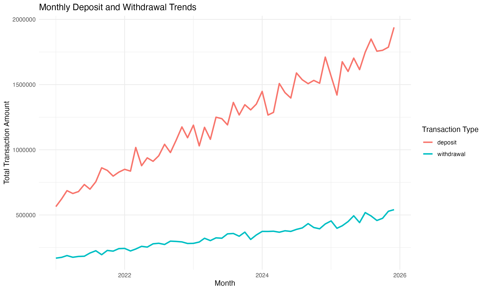
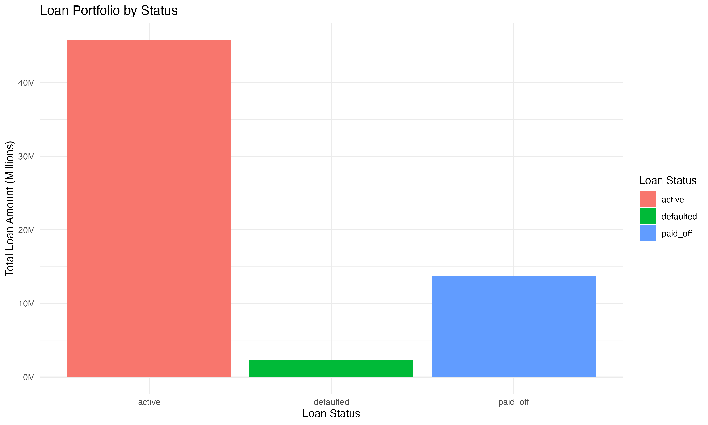
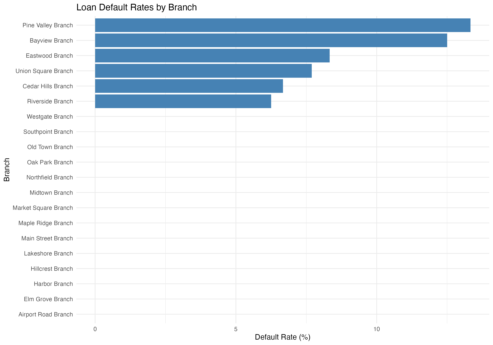

# Banking Transaction Analysis Using PostgreSQL and R

## 1. Project Overview

This project analyses a synthetic banking database using PostgreSQL and R. It focuses on banking transactions, loan portfolios, data quality assessment, and transaction amount distributions.

The main objectives are to:

- Analyse deposit and withdrawal trends.
- Examine loan portfolios, repayment activity, and branch-level default rates.
- Assess data quality through consistency and business-rule checks.
- Explore transaction amount distributions using descriptive statistics and percentile-based methods.
- Visualise key findings using R and ggplot2.

## 2. Tools and Technologies

- **PostgreSQL:** Data querying, aggregation, joins, common table expressions (CTEs), and window functions.
- **R (ggplot2):** Data visualisation.
- **VS Code:** SQL development and project organisation.
- **RStudio:** R scripting and chart generation.

## 3. Dataset

The project uses a publicly available synthetic banking database from [DatabaseSample](https://databasesample.com/datasets/bank-sample-database).

The database contains information about customers, accounts, transactions, loans, loan payments, and bank branches.

The analysis uses the 100K version of the dataset. Since the data is synthetic, the results are intended to demonstrate analytical methods rather than describe the performance of a real financial institution.

## 4. Analysis and Key Findings

### 4.1 Database Exploration

The project began with an exploration of the banking database to understand its structure and relationships.

Initial SQL queries were used to:

- Examine the tables and their key attributes.
- Identify relationships between customers, accounts, transactions, loans, and branches.
- Review transaction types and loan statuses.
- Understand the available data before conducting further analysis.

This exploration provided the foundation for subsequent banking operations, loan portfolio, and data quality analyses.

### 4.2 Banking Operations Analysis

SQL queries were used to examine banking transaction activity, including transaction volumes, deposit and withdrawal amounts, and account-level transaction patterns.

Key analytical techniques included:

- Aggregating transaction counts and amounts by transaction type.
- Analysing monthly deposit and withdrawal trends.
- Using window functions to calculate cumulative net transaction flows for individual accounts.

**Monthly Deposit and Withdrawal Trends**



The monthly transaction analysis shows an upward trend in both deposit and withdrawal amounts over the observed period. Deposit amounts consistently exceed withdrawal amounts.

These results illustrate transaction patterns within the synthetic dataset and should not be interpreted as actual banking industry trends.

### 4.3 Loan Portfolio Analysis

SQL queries were used to analyse loan portfolios, repayment activity, and branch-level loan default rates.

The analysis involved joining the `loans`, `loan_payments`, and `branches` tables to examine loan performance from different perspectives.

**Loan Portfolio by Status**



The dataset contains 300 loans:

- **Active:** 231 loans
- **Paid off:** 61 loans
- **Defaulted:** 8 loans

Active loans account for the largest share of the loan portfolio, both in number and total original loan amount.

**Loan Repayment Analysis**

Loan repayment activity was analysed by aggregating payment amounts, principal repayments, and interest payments across different loan statuses.

This provides an overview of recorded repayment activity and the composition of loan payments.

**Loan Default Rates by Branch**



Branch-level default rates were calculated as the percentage of loans classified as defaulted within each branch.

Pine Valley Branch recorded the highest default rate (13.33%), followed by Bayview Branch (12.50%).

However, the number of loans per branch is relatively small. Therefore, differences in default rates should be interpreted cautiously and should not be treated as reliable evidence of differences in underlying credit risk.

### 4.4 Data Quality Assessment

Data quality checks were performed using SQL to identify potential inconsistencies in banking records.

The assessment focused on:

- **Duplicate records:** Checking for duplicate transaction identifiers.
- **Referential integrity:** Identifying transactions without matching accounts.
- **Transaction validity:** Checking for non-positive transaction amounts.
- **Loan payment consistency:** Comparing total payment amounts with the sum of principal and interest payments.
- **Business-rule validation:** Examining potentially inconsistent account and loan activity.

The executed checks did not identify violations of the tested conditions.

These results suggest that the synthetic dataset is internally consistent with respect to the rules examined. However, passing these checks does not guarantee overall data quality, and additional validation would be required for real-world banking data.

### 4.5 Transaction Amount Distribution Analysis

Transaction amount distributions were analysed separately for deposits, withdrawals, fees, and interest payments.

Descriptive statistics, including mean, standard deviation, and the 95th percentile, were calculated for each transaction type.

**High-Value Transaction Analysis**

The 95th percentile was used to identify relatively high-value transactions within each transaction category.

Transactions exceeding this threshold were classified as high-value transactions for further examination, rather than automatically being considered suspicious.

**Statistical Outlier Detection**

Two statistical methods were compared:

- **Z-score method:** Transactions more than three standard deviations from their category mean.
- **Interquartile Range (IQR) method:** Transactions falling outside the 1.5 × IQR boundaries.

Neither method identified statistical outliers in the analysed transaction amounts.

This suggests that the transaction values are relatively concentrated within their respective categories under the selected thresholds.

**Limitations**

Statistical outlier detection alone cannot establish whether a transaction is fraudulent or suspicious. Additional information, such as customer behaviour, transaction frequency, and account history, would be required for a more comprehensive assessment.

## 5. Project Structure

The project is organised as follows:

```text
banking-sql-analysis/
├── data/                  # CSV files exported from SQL queries
├── figures/               # Visualisations generated using R
├── R/
│   └── visualization.R    # R code for generating charts
├── sql/
│   ├── 01_database_exploration.sql
│   ├── 02_banking_operations.sql
│   ├── 03_loan_analysis.sql
│   ├── 04_data_quality.sql
│   └── 05_transaction_outlier_analysis.sql
└── README.md
```

The SQL scripts cover database exploration, banking operations, loan portfolio analysis, data quality checks, and transaction amount distribution analysis.

The R script generates three visualisations from the SQL query results.

## 6. How to Run the Project

1. Download the PostgreSQL version of the 100K synthetic banking dataset from [DatabaseSample](https://databasesample.com/datasets/bank-sample-database).

2. Create a PostgreSQL database named `banking_analysis` and import the dataset using the provided SQL file.

3. Execute the SQL scripts in the `sql/` directory in numerical order.

4. Export the query results required for visualisation as CSV files into the `data/` directory.

5. Open `R/visualization.R` in RStudio, install and load `ggplot2` if necessary, and run the script to generate the charts.

6. The generated visualisations are saved in the `figures/` directory.

**Note:** Run the R script from the project root directory to ensure that relative file paths are resolved correctly.
